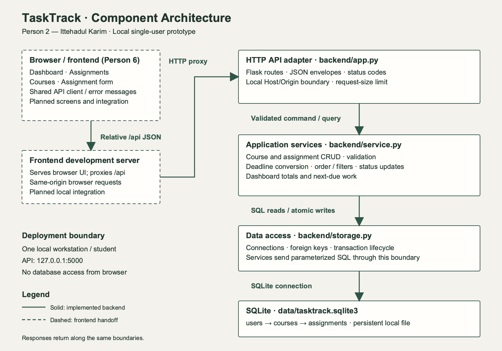

# TaskTrack — P2 Architecture

**Contributor:** Ittehadul Karim (Person 2)  
**Scope:** Frontend/backend/database architecture, API interactions, and local backend setup.  
**Sources:** [Requirements](Requirements.md), [P2 use cases](p2-use-case-analysis.md), and [design rationale](design-rationale.md).

## 1. Architecture and implementation status

TaskTrack uses a layered web architecture: a browser interface calls a JSON HTTP API; application services validate changes and calculate workload; a data layer persists records in SQLite. One backend process serves one local student's workspace. This implements the separation required by NFR-13 without adding distributed services.

| Layer | Responsibilities | Artifact and current status |
| --- | --- | --- |
| Frontend | Dashboard, assignment list/details, course list, assignment form, confirmation dialogs, responsive layout | [Frontend integration guide](../frontend/README.md); screens remain Person 6's contribution |
| Backend HTTP adapter | Routes, JSON responses, HTTP errors, local request boundary | [Flask application](../backend/app.py), implemented |
| Application services | Validate commands, manage courses and assignments, derive deadlines, sort/filter lists, compute dashboard | [Services](../backend/service.py), implemented |
| Data access | Connection lifecycle, parameterized SQL, transactions, foreign keys | [Storage](../backend/storage.py), implemented; services issue SQL through this boundary |
| Database | Persist local owner, courses, assignments; reject orphaned assignments and unsafe course deletion | [Schema](../data/schema.sql), implemented; runtime file is ignored by Git |
| Verification | Exercise API behavior against temporary SQLite databases | [Integration tests](../tests/test_backend.py) and [backend CI](../.github/workflows/backend.yml) |

The backend is runnable and tested separately. Browser screens, authentication, and a completed integrated prototype are not claimed by this contribution. The frontend uses the contract in [api.md](api.md); the shared class/ER model remains Person 3's responsibility.

## 2. Component diagram



[Editable SVG source](../diagrams/architecture.svg). Dashed components represent frontend work awaiting integration. Solid components exist in this branch. Arrows show calls and data movement; responses return through the same boundaries. SQLite is a local file with no browser-accessible database endpoint.

## 3. Frontend architecture

Four views share an API client and consistent form/error behavior:

- **Dashboard:** Fetch `/api/dashboard`; show pending, completed, overdue, and the next five pending assignments. Clicking a count opens a matching list filter.
- **Assignments:** Fetch `/api/assignments` with optional course/status filters. Open details, edit, delete, or mark complete/reopen from each item.
- **Courses:** Fetch `/api/courses`; create or rename a course; explain a blocked delete when assignments remain.
- **Assignment form:** Load courses, require title/course/date, accept optional description/time/type, and preserve entered values after failed saves. Adding a missing course calls the course API first and selects its returned ID.

The browser calls relative `/api` URLs through a local frontend development proxy. No frontend framework is imposed on the prototype owner. Render student text through escaped templates or `textContent`. Client checks provide immediate feedback; the server independently validates every write (FR-2.3, NFR-12).

After a successful mutation, reload the visible list and dashboard together. Disable repeated Save clicks while a request is pending. On page focus and once per minute, refresh deadline-derived views. Display load/save errors with a retry action; an error response must never become a false empty state (NFR-6). Delete confirmation belongs in the interface before the confirmed request is sent (FR-2.6).

## 4. Backend architecture and API interactions

Flask supplies the HTTP adapter. Route handlers delegate to application services, which use the SQLite connection layer. Validation finishes before an insert/update. Each write executes within a transaction; exceptions roll it back. Foreign keys are enabled for every connection. IDs, text, and filters are passed as bound SQL parameters; table names are internal constants.

| Workflow | Request sequence | Success and failure behavior | Use cases |
| --- | --- | --- | --- |
| Add assignment | GET courses → optionally POST course → POST assignment → refresh list/dashboard | 201 returns saved record and ID; 400 returns field errors without a partial assignment | UC-01, UC-03 |
| View deadlines | GET assignments with `status=Pending` and optional `course_id` | 200 returns due order; ties use case-insensitive title then ID; failed storage returns 503 | UC-06, UC-09 |
| Complete/reopen | PATCH assignment status → refresh list/dashboard | 200 returns committed state; repeated status selection is idempotent | UC-07, UC-08 |
| Edit assignment | GET assignment → PUT assignment → refresh views | Same assignment ID and completion status survive edits; invalid edits preserve old values | UC-04 |
| Delete assignment | Interface confirms title → DELETE with `confirmed=true` → refresh views | 204 on success; missing confirmation returns 400; missing record returns 404 | UC-05 |
| Rename/delete course | PUT course or confirmed DELETE course | Rename keeps assignment links; a course with assignments returns 409 and remains saved | UC-02 |
| Return later | Start backend with same database → GET courses, assignments, dashboard | Saved values return; overdue is recalculated from current time | UC-10 |

The [API contract](api.md) defines routes, request/response fields, status codes, curl examples, and frontend integration rules. A database error returns 503 without raw SQL or filesystem details. Startup fails if the configured database cannot be opened or initialized; it never silently replaces a damaged database.

## 5. Database architecture

SQLite is appropriate for this local prototype because the expected workload is about 200 assignments (NFR-7), one process, and one local student. There is no separate database service to configure. Persistence lives at `data/tasktrack.sqlite3` by default and survives process/browser restarts (FR-2.7).

| Table | Key fields | Relationships and constraints |
| --- | --- | --- |
| `users` | `id`, `display_name` | Seeds owner 1, `Local student`; represents logical ownership only |
| `courses` | `id`, `user_id`, `name`, `code` | Required user FK; name required; code optional |
| `assignments` | `id`, `course_id`, `title`, `description`, `due_date`, `due_time`, `task_type`, `status` | Required course FK; course deletion restricted; status is Pending or Completed |

Ownership follows `User → Course → Assignment`, consistent with the shared conceptual model. The single-user API does not accept a client-supplied user ID. There is no registration, password, or authentication implementation. FR-1.1 and FR-1.2 are deferred under the single-user option described in the requirements and P2 use cases. Adding accounts requires authentication and server-side ownership filtering for every read/write before a shared deployment.

Assignments store a calendar date and optional local time. The service resolves these to UTC for responses, sorting, and comparisons. Overdue and dashboard totals are derived; neither is a persisted column. The course FK has an index. Sorting a dataset of approximately 200 assignments in the service keeps the deadline policy in one place; this is a design choice, not a measured performance claim.

## 6. Deadline and count policy

This backend makes the use cases' open deadline decisions concrete for review:

- Workspace zone defaults to `America/Chicago`; configure `TASKTRACK_TIMEZONE` before creating data and keep it stable for that workspace. Changing it reinterprets every stored local deadline.
- `due_date` is `YYYY-MM-DD`; optional `due_time` is 24-hour `HH:MM`. Omitting time resolves to **23:59** in the workspace zone. Past deadlines are allowed.
- A deadline is overdue only when `due_at < now` and status is Pending. At the exact deadline it remains due. A nonexistent spring clock-change time is rejected; an ambiguous fall clock-change time uses its earlier occurrence.
- Pending counts **all unfinished assignments**, including overdue ones. Overdue is a subset of pending. Completed assignments never count as overdue. These counts should not be summed as three mutually exclusive groups.
- Next due lists the earliest five Pending assignments, including overdue work. Deadline ties use title, then ID. Filters never change stored data.

The timezone/default-time choices are implemented prototype defaults proposed for team review; they resolve the open questions in the P2 analysis without editing another contributor's document.

## 7. Local deployment

Prerequisites: Python 3.12 or newer, pip, and a writable checkout on a local disk. No cloud account or external service is required. Run from the repository root:

```sh
python3 -m venv .venv
source .venv/bin/activate
python -m pip install -r backend/requirements.txt
python -m backend.app
```

The API listens on `http://127.0.0.1:5000`. Debug mode is disabled. Startup creates the database tables and logical local owner. It does not insert sample courses/assignments. To use another file or zone, configure before launch:

```sh
export TASKTRACK_DATABASE="$PWD/data/demo.sqlite3"
export TASKTRACK_TIMEZONE="America/Chicago"
python -m backend.app
```

Keep the database file outside the frontend's public/static directory. The runtime database, virtual environment, and environment files are ignored by Git. Stop the backend before copying the SQLite file for a backup. Reusing the same file restores saved work. Changing the database path selects a different workspace. `CREATE TABLE IF NOT EXISTS` initializes this first schema; future schema changes require explicit migrations.

The frontend owner's development server must proxy `/api` to port 5000. For example, a frontend at `http://localhost:5173` sends browser requests to its own `/api`, and its proxy forwards to `http://127.0.0.1:5000` while preserving the browser Host/Origin relationship. The API permits localhost/127.0.0.1 hosts and same-origin requests. A proxy that rewrites Host must also make Origin consistent for trusted local requests. No permissive CORS configuration is provided.

This setup is for a local single-user demonstration. The Flask development server, logical owner, and local SQLite file do not constitute an authenticated shared deployment. Multi-user hosting would require a production server, HTTPS, authentication/authorization, backups, migrations, and reviewed ownership queries.

## 8. Verification and handoff

[Person 2 contribution evidence](person-2-contribution.md) records the owned issue, implementation commit, and pull request for the final report.

Run the same backend tests as CI:

```sh
python -m unittest discover -s tests -v
npx markdownlint-cli2 "**/*.md"
python3 scripts/check_traceability.py
```

Ten API integration tests cover persistence across application restart, invalid creates/edits, safe course deletion, confirmation, filtering/sorting, complete/reopen counts, deadline equality and DST, failed-write rollback, failed reads, malformed JSON, local request checks, and empty state. Tests use temporary files and a fixed clock; they do not modify a student's database.

Frontend timing, click counts, responsive layout, and browser compatibility remain integrated acceptance work (NFR-1, NFR-2, NFR-7, NFR-8, NFR-9, NFR-10). Backend test success alone does not prove these UI requirements. Person 6 can use the curl examples to connect screens; Persons 3 and 5 can map the concrete routes and boundaries to their shared models.

| Architecture element | Requirement links |
| --- | --- |
| Assignment validation, writes, details, confirmation | FR-2.1, FR-2.2, FR-2.3, FR-2.4, FR-2.5, FR-2.6, FR-2.7, FR-3.4 |
| Ordered lists, derived overdue, filters | FR-3.1, FR-3.2, FR-3.3, FR-5.1, FR-5.2, FR-5.4, FR-6.2, NFR-5 |
| Completion and dashboard API | FR-4.1, FR-4.2, FR-4.3, FR-4.4, FR-6.1, FR-6.3, FR-6.4 |
| Course API and persistent relationships | FR-5.3, NFR-4, NFR-6 |
| Input checks and layered modules | NFR-12, NFR-13 |
| Branch, issue, PR, CI, peer review workflow | NFR-14 |
