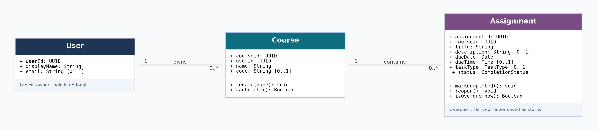
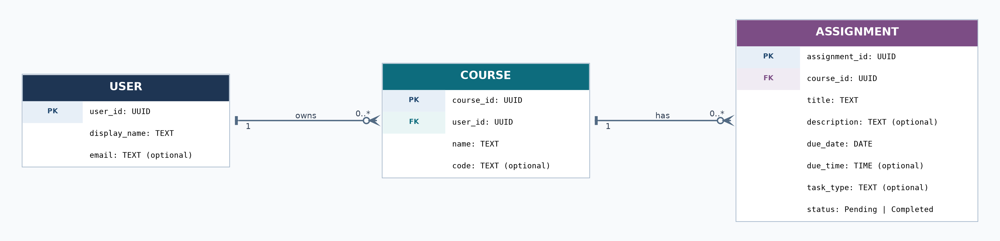

# TaskTrack — High-Level Design

**Course:** CS 3354 — Software Engineering  
**Milestone:** Project 2 — Analysis and High-Level Design  
**Project:** TaskTrack — Student Assignment Management System

## 1. Overview

TaskTrack is a browser-based application for tracking assignments, exams, and course deadlines. Students can create courses, add and update assignments, mark work complete, and use an upcoming-work list and dashboard to see their progress. This design defines the main objects and their relationships so the architecture, implementation, and prototype can follow the same rules.

The model is based on the existing [requirements](Requirements.md) and [use cases](Use_Case.md). Account registration is **optional** in FR-1.1 and FR-1.2, so `User` is included as a *logical owner* of data, not as a claim that registration or login is implemented. A single-user prototype can use one local owner; an actual multi-user deployment must authenticate users and enforce ownership on the server.

## 2. High-level system structure

TaskTrack uses three logical layers to keep the design manageable:

| Layer | Responsibilities | Example components |
| --- | --- | --- |
| Presentation | Forms, dashboard, assignment list, course filters, validation messages, delete confirmation, responsive layout | Dashboard, Upcoming, Course List, Assignment Form |
| Application logic | Validate commands, manage courses/assignments, sort by deadline, calculate overdue status and dashboard totals | CourseService, AssignmentService, DashboardService |
| Data access and persistence | Load and save users, courses, and assignments; preserve relationships; report storage errors | UserRepository, CourseRepository, AssignmentRepository |

The presentation layer requests an action from the application layer, which validates it and uses the persistence layer. After a successful write, the application refreshes the affected list and dashboard. A failed write leaves the original saved record in place and displays an error. These layers are *design responsibilities*, not a claim that the code already exists.

For the intended web deployment, a browser serves as the front end, an application server owns the logic and API, and persistent storage holds the records. The exact framework, database, and hosting service are not decided here. Keeping the data-access interface separate means the team can test with a simple local or mock store without tying the rest of the application to a specific database.

## 3. Main classes and responsibilities

| Class | Main data | Responsibility |
| --- | --- | --- |
| `User` | `userId`, `displayName`, optional `email` | Represents the owner of courses. Account credentials and authentication, if added, are handled separately. |
| `Course` | `courseId`, `userId`, `name`, optional `code` | Groups related assignments and links them to one user. Renaming a course preserves its assignments. |
| `Assignment` | `assignmentId`, `courseId`, `title`, optional `description`, `dueDate`, optional `dueTime`, optional `taskType`, `status` | Stores a task or exam, its course and deadline, and whether the student has completed it. |

The `status` field has only two stored values: **Pending** and **Completed**. **Overdue** is a calculated condition: an assignment is overdue when its resolved deadline has passed and its stored status is Pending. It is not a third persisted status. `taskType` can distinguish an assignment, quiz, or exam if the prototype includes that optional field.

### Relationships and constraints

- **User → Course: one-to-many.** One user can own zero or more courses; each course belongs to exactly one user. `Course.userId` references `User.userId`.
- **Course → Assignment: one-to-many.** One course can contain zero or more assignments; each assignment belongs to exactly one course. `Assignment.courseId` references `Course.courseId`.
- **User → Assignment: indirect ownership.** A student owns an assignment through its course. A separate `userId` in `Assignment` is unnecessary because it could disagree with `Course.userId`.
- **Course deletion:** A course with linked assignments cannot be deleted until those assignments are reassigned or deleted. This prevents accidental loss of work (UC-02).
- **Required fields:** An assignment needs a nonblank title, a valid existing course, and a valid due date. Description and due time may be omitted (FR-2.2, FR-2.3).

## 4. Class diagram

The class diagram shows the three domain classes, their key attributes, and basic behaviors. `Assignment.isOverdue(now)` is derived from the saved deadline and completion status. `Course.canDelete()` expresses the rule that a course must have no linked assignments before it can be removed. Service classes handle the actual storage operations; the methods shown describe domain behavior, not a required programming language or framework.

## 5. Entity-relationship diagram

The ER diagram expresses the same relationships as persistent records. **PK** means primary key, and **FK** means foreign key. Both foreign keys are required: `Course.user_id` links to `User.user_id`, and `Assignment.course_id` links to `Course.course_id`. A user can have no courses yet, and a course can have no assignments yet; however, an existing course or assignment cannot point to a missing parent. Referential integrity should prevent orphaned records.

`Overdue` and dashboard totals are not database columns. They are computed from assignments when needed, which avoids stale values after a deadline passes or a task is reopened. The database diagram is conceptual: the final schema may add technical fields such as timestamps or indexes without changing these relationships.

## 6. Main views and application interfaces

| View or operation | Behavior | Related use cases |
| --- | --- | --- |
| Course List / `createCourse`, `updateCourse`, `deleteCourse` | Add or rename courses; block deletion when assignments still reference a course | UC-01, UC-02 |
| Assignment Form / `createAssignment`, `updateAssignment`, `deleteAssignment` | Check required fields, save changes, and ask for confirmation before permanent deletion | UC-03, UC-04, UC-05 |
| Upcoming / `listAssignments(filters, sort)` | Show pending work in deadline order; display overdue labels; allow course/status filters | UC-06, UC-09 |
| Status Control / `setCompletionStatus` | Mark complete or reopen an assignment, persist the change, and update visible summaries | UC-07 |
| Dashboard / `getDashboardSummary` | Compute pending, completed, and overdue counts and show the next deadlines; counts open matching lists | UC-08 |
| Startup / `loadCoursesAndAssignments` | Reload saved data, recompute deadlines, and report failed reads instead of showing incorrect zero counts | UC-10 |

These interfaces describe the actions the application must support; they are not fixed HTTP routes or a claim of working endpoints. Core actions should remain available within two clicks or taps from the main view (NFR-2).

## 7. Business rules and consistency

1. **Creation and editing:** Validate title, course reference, and due date before saving. An edit updates the existing assignment rather than creating a duplicate. If saving fails, keep the original stored record and show an error.
2. **Completion:** Completing a task sets its stored status to Completed; reopening it sets the status to Pending. Neither operation changes the assignment ID or course relationship.
3. **Overdue:** Only an incomplete assignment past its deadline is overdue. A completed assignment with a past due date stays completed. When a user reopens an old task, its overdue indicator is recalculated.
4. **Dashboard counts:** `pendingCount` counts all Pending tasks, including overdue ones. `completedCount` counts Completed tasks, and `overdueCount` counts only overdue Pending tasks. Thus overdue is a subset of pending, not an additional saved status. Counts refresh after a successful write.
5. **Sorting:** Pending tasks appear from earliest to latest deadline, with title as a tie-breaker (UC-06). Filters change only what is displayed, not the stored assignment records.
6. **Deletion:** Deleting an assignment requires confirmation and removes only the selected record. Cancelling or a storage failure leaves it unchanged. Course deletion must never silently cascade to assignments.
7. **Missing data and failures:** A genuinely empty account shows a helpful empty state. Failure to load data displays an error; it must not be represented as an empty dashboard.

A due date is required, while a due time is optional. The team must agree on a **default deadline time and time-zone policy** before implementing overdue calculation. Until then, the model keeps `dueDate` and optional `dueTime` separately instead of assuming an undocumented default.

## 8. Requirements and use-case traceability

| Design element | Requirements supported | Use cases |
| --- | --- | --- |
| `User` and course ownership | FR-1.1, FR-1.2 (if accounts are enabled), FR-5.3 | UC-01, UC-02 |
| `Course`–`Assignment` relationship | FR-2.1, FR-5.1, FR-5.2, FR-5.4 | UC-01, UC-02, UC-03, UC-09 |
| Assignment validation and persistence | FR-2.2, FR-2.3, FR-2.4, FR-2.5, FR-2.6, FR-2.7, NFR-4, NFR-6 | UC-03, UC-04, UC-05, UC-10 |
| Deadline ordering and derived overdue state | FR-3.1, FR-3.2, FR-3.3, FR-3.4, FR-6.2, NFR-5 | UC-06, UC-08, UC-09 |
| Completion status and dashboard | FR-4.1, FR-4.2, FR-4.3, FR-4.4, FR-6.1, FR-6.3, FR-6.4 | UC-07, UC-08 |
| Layered, browser-based structure | NFR-1, NFR-2, NFR-3, NFR-7, NFR-8, NFR-9, NFR-10, NFR-13 | UC-01 through UC-10 |
| Validation, privacy and review | NFR-11 (if accounts are enabled), NFR-12, NFR-14 | UC-03, UC-04, UC-05, UC-10 |

## 9. Security, deployment, and decisions to confirm

When accounts are implemented, the application server must authenticate users and enforce ownership when loading or changing a course or assignment. Authorization for an assignment follows the ownership of its parent course. Passwords must be securely hashed, never stored in plain text (NFR-11). In every version, inputs must be validated, and user-provided text must be safely rendered to avoid script injection (NFR-12).

The initial implementation should target current Chrome, Firefox, Safari, and Edge, with a layout that also works in mobile browsers (NFR-9, NFR-10). The requirements call for list/page loads within three seconds at about 200 assignments and for visible updates within one second after normal actions (NFR-7, NFR-8). These are **requirements to test**, not measured results.

Before implementation, the team should confirm three choices: whether P2 includes login or a single-user prototype; the default due time and time-zone handling; and the exact storage technology. None of these decisions changes the central `User → Course → Assignment` relationship shown in both diagrams.
