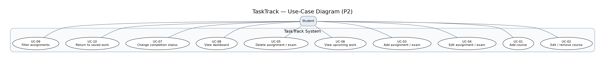

# TaskTrack — P2 Use-Case Analysis

**Course:** CS 3354 — Software Engineering  
**Project:** TaskTrack — Student Assignment Management System  
**Contributor:** Ahmed Neematallah  
**Milestone:** Project 2 — Analysis and High-Level Design  
**Source:** [Project 1 requirements](https://github.com/ahneematallah-boop/TaskTrack-CS3354/blob/main/docs/Requirements.md) and [Project 1 use cases](https://github.com/ahneematallah-boop/TaskTrack-CS3354/blob/main/docs/Use_Case.md)

## 1. Purpose and scope

TaskTrack is meant to help a student keep assignments, exams, and deadlines in one place. Instead of checking several course pages, the student can add schoolwork, see what is due next, and track what is finished. This analysis takes the use cases from Project 1 and explains the main user actions, what TaskTrack needs to do in response, and how it should handle common problems.

The main features are course organization, assignment management, deadline tracking, completion status, and the dashboard. Account registration is optional in the Project 1 requirements, so it is **not assumed to be part of the first prototype**. If the team chooses to add accounts, it must also design sign-in and user-specific access for FR-1.1 and FR-1.2. The designs below can work in the simpler single-user version.

## 2. Actor and system responsibilities

**Primary actor — Student:** Adds courses and assignments, changes details, marks work complete, and checks deadlines. The student starts all the use cases below.

**Outside the system — Professor:** Gives students assignments and due dates, but does not directly use TaskTrack. A professor is therefore not drawn as an interacting actor.

**TaskTrack's responsibilities:** Show simple forms, check required fields, save changes, load saved data, order tasks by deadline, calculate overdue status, and show clear errors when an action fails. The student enters information; TaskTrack handles validation and display.

## 3. Use-case diagram

The system boundary shows what TaskTrack handles. Lines from the Student actor show the actions the student can start. The *Add Assignment* use case can lead to *Add Course* when the needed course is missing. The diagram keeps that connection simple; the actual decision is described in UC-03 below.

## 4. Use-case overview

| ID | Student goal | Project 1 requirement links |
| --- | --- | --- |
| UC-01 | Add a course | FR-5.3, FR-2.7 |
| UC-02 | Edit or remove a course | FR-5.4, FR-2.7 |
| UC-03 | Add an assignment or exam | FR-2.1, FR-2.2, FR-2.3, FR-2.7, FR-5.1, FR-5.3, FR-6.2 |
| UC-04 | Edit an assignment or exam | FR-2.4, FR-2.3, FR-2.7, FR-6.2 |
| UC-05 | Delete an assignment or exam | FR-2.5, FR-2.6, FR-2.7, FR-6.1 |
| UC-06 | View upcoming assignments | FR-3.1, FR-3.2, FR-3.3, FR-6.2 |
| UC-07 | Mark work complete or incomplete | FR-4.1, FR-4.2, FR-4.3, FR-4.4, FR-2.7 |
| UC-08 | View dashboard | FR-6.1, FR-6.2, FR-6.3, FR-6.4, FR-3.4 |
| UC-09 | Filter assignments | FR-5.2, FR-5.4 |
| UC-10 | Return to saved assignments | FR-2.7, FR-6.2, NFR-6 |

These IDs match Project 1, so the architecture and prototype teams can refer to the same use cases without renaming them.

## 5. Main and alternate flows

### UC-01 — Add a course

**Goal:** Give assignments a course to belong to.  
**Before starting:** TaskTrack is open.  
**Main flow:** (1) The student selects **Add Course**. (2) TaskTrack shows a course-name field and an optional code. (3) The student enters the course and selects **Save**. (4) TaskTrack checks the name, saves the course, and adds it to the course list.  
**Other flows:** If the name is blank, TaskTrack explains what is missing and does not save. If the student cancels, nothing changes. If saving fails, the form stays open so the student can try again.  
**Result:** The new course can be used for assignments.

### UC-02 — Edit or remove a course

**Goal:** Fix a course name or remove one that is no longer needed.  
**Before starting:** A course already exists.  
**Main flow:** (1) The student opens the course list and selects **Edit**. (2) TaskTrack shows the current course details. (3) The student changes the name and saves it. (4) TaskTrack updates the course and shows the new name on related assignments.  
**Other flows:** A blank name is rejected. A course with no assignments can be deleted after confirmation. A course with linked assignments cannot be removed until those assignments are moved or removed. Canceling makes no changes; a save error keeps the old values.  
**Result:** Course details are updated without breaking assignment links.

### UC-03 — Add an assignment or exam

**Goal:** Save a new deadline.  
**Before starting:** The student has a course to select, or can add one during the process.  
**Main flow:** (1) The student chooses **Add Task**. (2) TaskTrack shows title, course, due date, and optional details. (3) The student fills out the required fields and selects **Save**. (4) TaskTrack checks the entries. (5) TaskTrack saves the task as pending and puts it in the list in deadline order.  
**Other flows:** If the course is missing, the student can add it first (UC-01). Missing title, course, or date and invalid dates show field-level errors. Canceling saves nothing. A past due date is allowed but is shown as overdue while the task is pending. A save failure must not create a partial or duplicate entry.  
**Result:** One new assignment or exam is saved.

### UC-04 — Edit an assignment or exam

**Goal:** Correct a deadline or other task details.  
**Before starting:** The task exists.  
**Main flow:** (1) The student selects a task and chooses **Edit**. (2) TaskTrack fills the form with its saved information. (3) The student updates the fields and selects **Save**. (4) TaskTrack validates and updates the existing task. (5) The list and dashboard reflect the changes.  
**Other flows:** Invalid required fields are rejected. Canceling keeps the previous information. Moving a deadline into the past may change the task to overdue if it is incomplete. If saving fails, the old saved version remains.  
**Result:** The same task is updated, not copied.

### UC-05 — Delete an assignment or exam

**Goal:** Remove a task that was added by mistake or is no longer needed.  
**Before starting:** The task exists.  
**Main flow:** (1) The student selects **Delete** on a task. (2) TaskTrack asks for confirmation and shows the task name. (3) The student confirms. (4) TaskTrack removes the saved task and updates the list and dashboard.  
**Other flows:** If the student cancels, the task stays. If the delete fails, TaskTrack tells the student and keeps the task rather than pretending it was removed.  
**Result:** Only the confirmed task is deleted.

### UC-06 — View upcoming assignments

**Goal:** See what needs attention first.  
**Before starting:** TaskTrack is open; the list may be empty.  
**Main flow:** (1) The student opens **Upcoming**. (2) TaskTrack loads pending tasks. (3) TaskTrack sorts them from the closest due date to the latest. (4) The student sees each title, course, date, and overdue label when needed.  
**Other flows:** If there is no pending work, TaskTrack shows a helpful empty message instead of a blank screen. If multiple tasks have the same deadline, it uses a consistent secondary order. If loading fails, TaskTrack shows an error rather than an incorrect empty list.  
**Result:** The student knows which unfinished task is next.

### UC-07 — Mark work complete or incomplete

**Goal:** Keep the task list accurate as work gets finished.  
**Before starting:** The task exists.  
**Main flow:** (1) The student marks a pending task **Complete**. (2) TaskTrack saves the new status. (3) The task looks completed and dashboard totals update. (4) If needed, the student can mark it **Incomplete** again. (5) TaskTrack restores its pending status and checks whether it is now overdue.  
**Other flows:** Selecting complete on an already completed task should not create another task. If the status change cannot be saved, TaskTrack keeps the previous saved status and shows an error.  
**Result:** The saved task status and dashboard agree.

### UC-08 — View the dashboard

**Goal:** Understand the workload without opening every assignment.  
**Before starting:** TaskTrack is open.  
**Main flow:** (1) The student opens **Dashboard**. (2) TaskTrack loads saved assignments and calculates pending, completed, and overdue counts. (3) It displays the next items due. (4) The student can select a count or an assignment to open the matching list or details.  
**Other flows:** With no assignments, the dashboard displays zero counts and a suggestion to add one. A completed task with an old deadline counts as completed, not overdue. A loading problem shows an error rather than made-up totals.  
**Result:** The dashboard matches the saved assignment data.

### UC-09 — Filter assignments

**Goal:** Look at only the work for one course or status.  
**Before starting:** At least one task exists.  
**Main flow:** (1) The student opens the assignment list. (2) The student selects a course and/or a status filter. (3) TaskTrack shows only matching assignments while keeping them in deadline order. (4) The student can clear filters to see everything again.  
**Other flows:** If nothing matches, TaskTrack displays a **No matching assignments** message. A removed course should not remain as an available filter.  
**Result:** The student sees the requested subset without changing saved tasks.

### UC-10 — Return to saved assignments

**Goal:** Continue using TaskTrack without entering the same work again.  
**Before starting:** Some information has been saved in an earlier session.  
**Main flow:** (1) The student closes TaskTrack and returns later. (2) TaskTrack loads previously saved courses, assignments, and statuses. (3) It checks deadlines again and refreshes the overdue labels and dashboard. (4) The student resumes working with the saved data.  
**Other flows:** If this is the first visit, TaskTrack shows an empty starting view. If data cannot be loaded, it explains the error and does not silently replace the user's saved information with blank data.  
**Result:** Saved work is still available and the due-date information is current.

## 6. Shared rules for the design team

To keep the diagrams and prototype consistent, the rest of the team should follow these rules:

1. Every assignment belongs to a course and has a title and due date. Description is optional.
2. Assignments have a saved status of **Pending** or **Completed**. **Overdue** is calculated when a pending assignment's due date has passed; it is not a separate saved completion status.
3. A task that is completed is not counted as overdue, even when its due date is in the past.
4. A student must confirm before permanently deleting an assignment.
5. Failed save or delete operations must not make the screen look as though a change succeeded.
6. Course removal should not silently delete assignments linked to that course.
7. Saved assignment details and dashboard totals need to stay in sync.

## 7. Connection to Project 2 design and prototype

| Use cases | What the architecture/design should support | Good prototype evidence |
| --- | --- | --- |
| UC-01, UC-02 | Course records and course-to-assignment relationships | Add/edit course screen and course list |
| UC-03, UC-04, UC-05 | Task form, input checks, save/update/delete operations | Assignment form, validation message, delete confirmation |
| UC-06, UC-09 | Deadline sorting and filtering | Upcoming list and course/status filters |
| UC-07, UC-08 | Saved completion status and computed dashboard values | Complete/incomplete action and updated counts |
| UC-10 | Persistent storage and error handling | Reloaded saved work or documented prototype behavior |

These are design and prototype expectations, **not claims that the features have already been implemented**. The architecture and prototype owners should link their actual files or screenshots after their work is completed.

## 8. Notes and decisions to confirm as a team

- **Account scope:** Project 1 makes login optional. Confirm whether P2 uses single-user mode or includes registration and sign-in. If accounts are included, add an account-access use case and link FR-1.1/FR-1.2.
- **Course deletion:** The safe behavior described above blocks deletion when assignments are still attached. The team should confirm that rule before implementing it.
- **Due times:** Project 1 allows an optional time for tasks. Agree on a default time and time-zone behavior so sorting and overdue labels are consistent.
- **Prototype evidence:** The prototype owner should pick a few flows to demonstrate rather than claiming every flow is working.

## 9. Individual contribution summary

My part of P2 focuses on how a student uses TaskTrack. I checked the requirements and use cases from Project 1, then organized the main interactions, alternate paths, and system responses into one analysis. I also made the use-case diagram and connected the flows to the design and prototype work that the rest of the team will do. This gives the team a common reference when building the architecture, data model, and screens.

**Contribution evidence to add after uploading:** GitHub issue URL, commit URL, pull request URL, and review links (where applicable). These should point to real GitHub activity, not example links.
